<h1 align="center">RoboARC: Physical Puzzles for Robotic Manipulation under Spatial Constraints</h1>

<p align="center">
  <a href="https://roboarc.embodied-first-exam.ai"></a>
  <a href="https://arxiv.org/abs/2611.33390"></a>
  <a href="https://huggingface.co/datasets/RoboARC/RoboARC-outputs"></a>
  <a href="LICENSE"></a>
</p>

<p align="center">
  <a href="https://qinengwang-aiden.github.io/">Qineng Wang</a><sup>1*</sup>,
  <a href="https://www.linkedin.com/in/jianwen-lyu-ba9a11329/">Jianwen Lyu</a><sup>1*</sup>,
  <a href="https://williamzhangsjtu.github.io/">Pingyue Zhang</a><sup>1*</sup>,
  <a href="https://www.microsoft.com/en-us/research/people/tanreuben/">Reuben Tan</a><sup>2†</sup>,
  <a href="https://whoknowsssss.github.io/al-folio/">Xiaoyu Huang</a><sup>3†</sup>,
  <a href="https://tonghezhang.com/">Tonghe Zhang</a><sup>4†</sup>,<br>
  <a href="https://jameskrw.github.io/">Kangrui Wang</a><sup>1</sup>,
  <a href="https://scholar.google.com/citations?user=S6OFEFEAAAAJ">Yelong Shen</a><sup>2</sup>,
  <a href="https://www.microsoft.com/en-us/research/people/jfgao/">Jianfeng Gao</a><sup>2</sup>,
  <a href="https://www.gshi.me/">Guanya Shi</a><sup>4</sup>,
  <a href="https://ruohanzhang.com/">Ruohan Zhang</a><sup>1</sup>,
  <a href="https://limanling.github.io/">Manling Li</a><sup>1</sup>
</p>

<p align="center"><sup>1</sup>Northwestern University &nbsp; <sup>2</sup>Microsoft &nbsp; <sup>3</sup>UC Berkeley &nbsp; <sup>4</sup>Carnegie Mellon University<br>
<sup>*</sup>Equal contribution &nbsp; <sup>†</sup>Core contributor</p>

<!-- The gallery: twelve GIFs, four rows of three, each linked to its task page. docs/assets/gallery/README.md lists
     them and docs/assets/gallery/make_gallery.py remakes them. -->
<p align="center">
  <a href="https://www.embodied-first-exam.ai/tasks/?task=roboarc/interlocked_claws_05">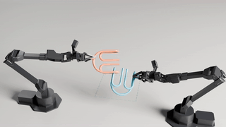</a>
  <a href="https://www.embodied-first-exam.ai/tasks/?task=roboarc/hedgehog_in_cage_03">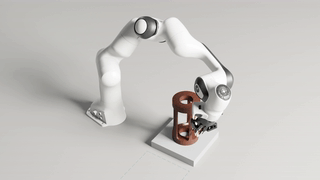</a>
  <a href="https://www.embodied-first-exam.ai/tasks/?task=roboarc/ikea_gladom">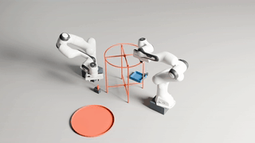</a>
</p>
<p align="center">
  <a href="https://www.embodied-first-exam.ai/tasks/?task=roboarc/knot_untying_04">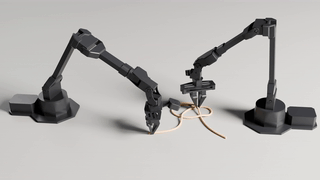</a>
  <a href="https://www.embodied-first-exam.ai/tasks/?task=roboarc/rope_threading_08">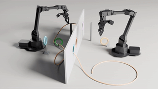</a>
  <a href="https://www.embodied-first-exam.ai/tasks/?task=roboarc/blanket_fold_03">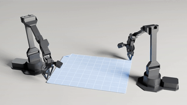</a>
</p>
<p align="center">
  <a href="https://www.embodied-first-exam.ai/tasks/?task=roboarc/cast_coil_08">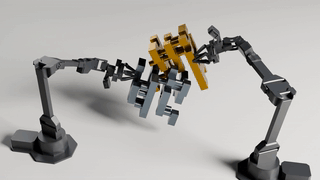</a>
  <a href="https://www.embodied-first-exam.ai/tasks/?task=roboarc/hedgehog_in_cage_06">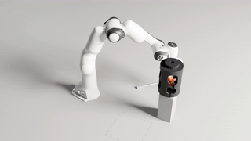</a>
  <a href="https://www.embodied-first-exam.ai/tasks/?task=roboarc/slotted_post_ring_05">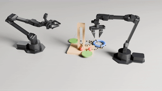</a>
</p>
<p align="center">
  <a href="https://www.embodied-first-exam.ai/tasks/?task=roboarc/ikea_vesken">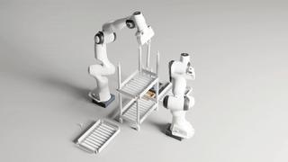</a>
  <a href="https://www.embodied-first-exam.ai/tasks/?task=roboarc/fiber_bundling_08">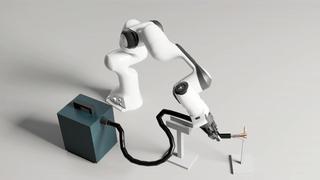</a>
  <a href="https://www.embodied-first-exam.ai/tasks/?task=roboarc/blanket_flatten_04">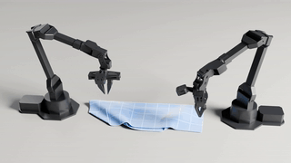</a>
</p>

<p align="center"><b>Six constraint types:</b> interlocking · narrow passage · assembly · untangling · threading · shape control<br>
<b>Three robots:</b> ALOHA 2 · Franka Panda with a Robotiq 2F-85 · two Franka Pandas</p>

**RoboARC** is a benchmark of physical puzzles for robot manipulation. Many hard manipulation tasks come down to a
spatial constraint that only a few motions satisfy, such as passing a part through a gap barely wider than itself or
separating two interlocked parts. RoboARC has 90 such tasks in six constraint types over rigid and soft materials, on
three robots, simulated in MuJoCo. Every task is one frozen scene with a physics-based grader and a verified reference
solution that replays bit-identically. Each task comes in two modes, which the paper calls regimes: **Privileged**,
with the full simulator state and resets, and **Standard**, with camera images, proprioception and a single attempt.
Coding agents, vision-language-action (VLA) policies and any other policy solve the same tasks under the same physics
and the same graders.

> **When manipulation hinges on spatial constraints, can robots reason out the right motions?**

<p align="center">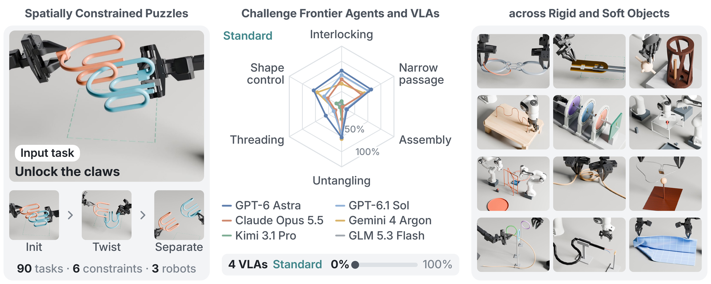</p>

<p align="center"><b>Figure 1.</b> RoboARC asks whether robots can reason out the right motions when manipulation
hinges on spatial constraints. Its 90 tasks span six constraint types over rigid and soft materials (left and right).
In the Standard mode the strongest coding agent solves 43 % of the tasks (middle).</p>

## News

- <!-- release date, as **YYYY-MM-DD**: --> Code release: the 90 tasks with their graders and reference solutions, the
  `roboarc` command line, the Python API and the container images.

## Table of Contents

- [Installation](#installation)
- [Quick start](#quick-start)
- [Tasks](#tasks)
- [Evaluation](#evaluation)
  - [Coding agents](#coding-agents)
  - [Python API](#python-api)
  - [VLA policies](#vla-policies)
- [Results](#results)
- [Optional: build the images yourself](#optional-build-the-images-yourself)
- [Repository layout](#repository-layout)
- [Checks](#checks)
- [Citation](#citation)
- [Licence](#licence)
- [Acknowledgements](#acknowledgements)

## Installation

### Requirements

- **Host:** Linux x86_64 with git and Python 3.11 or newer.
- **GPU:** an NVIDIA GPU with RT cores and driver 580 or newer. The renderer path-traces with Vulkan ray queries, which
  NVIDIA offers on GeForce RTX 20-series or newer, RTX workstation GPUs, T4, L4, L40 / L40S, A10 / A10G and A40.
  Step 2 checks your GPU, and [docs/RUNNING.md](docs/RUNNING.md#gpus-without-rt-cores) says what runs on other GPUs.
- **Docker:** [Docker Engine](https://docs.docker.com/engine/install/) with the Compose plugin and the
  [NVIDIA Container Toolkit](https://docs.nvidia.com/datacenter/cloud-native/container-toolkit/latest/install-guide.html).
- **Disk:** about 2 GB for the clone and 19 GB for the four images.
- **Per trial:** what the task declares: one GPU with 2 GB of free GPU memory, 2 to 6 CPU cores and 2 to 10 GB of
  memory.

### 1. Clone and install

<!-- unverified: the anonymous clone works once the repository is public -->
```bash
curl -LsSf https://astral.sh/uv/install.sh | sh      # uv (https://docs.astral.sh/uv/); then open a new shell
git clone https://github.com/mll-lab-nu/RoboARC.git
cd RoboARC
uv venv --python 3.12 && source .venv/bin/activate   # Python 3.12 as python3, in .venv/
uv pip install -e .                                  # the roboarc command and the Python package
roboarc --version                                    # roboarc 2.2.1
```

In a Python 3.11 or newer environment of your own, `pip install -e .` installs the same command.

[Harbor](https://github.com/laude-institute/harbor) runs the tasks for coding agents. Install the pinned version 0.27.0 with
uv, which also fetches the Python that Harbor needs (3.12 or newer):

```bash
uv tool install harbor==0.27.0       # the pinned Harbor version
harbor --version
```

### 2. Check the machine

```bash
roboarc doctor
```

One line per check, and for each check that fails, the fix. The values are your machine's:

```text
RoboARC 2.2.1, this host
  ok    python3                   3.12.9
  ok    repository                /work/RoboARC: RoboARC 2.2.1, 90 tasks
  ok    GPU                       0: NVIDIA L4, 23034 MiB
  ok    NVIDIA driver             580.95.05
  ok    Vulkan ray query          vulkaninfo names VK_KHR_ray_query, VK_EXT_extended_dynamic_state3, VK_KHR_compute_shader_derivatives
  ok    Docker                    server 27.3.1
  ok    Docker Compose            2.29.7
  ok    NVIDIA Container Toolkit  NVIDIA Container Toolkit CLI version 1.20.1
  ok    Harbor                    0.27.0
  FAIL  pinned images             0 of 4 are local; missing: ghcr.io/mll-lab-nu/roboarc:2.2.0, ...
                                  -> roboarc images pull
doctor: 1 failed
```

The Vulkan check reads `vulkaninfo`, which is in the package `vulkan-tools`. Step 3 brings the images.

### 3. Get the images

The simulator, the renderer and every task's frozen scene are in four container images, each pinned by digest in
[`images/pins.json`](images/pins.json). Pulling or building the images accepts the third-party licences listed in
[LICENSES/THIRD_PARTY.md](LICENSES/THIRD_PARTY.md), and `--accept-licences` records that acceptance once per user.

<!-- unverified: the anonymous pull from ghcr.io works once the packages are public -->
```bash
roboarc images pull --accept-licences
```

It pulls each image by its digest, checks it against its pin and ends with
`pull_all: every pinned image is local with its pinned id`. `roboarc doctor` then ends with
`doctor: every check passed`. Do this step before the first `harbor run`: every later command expects the images to be
local.

<details>
<summary>The four images</summary>

| image | on disk | used by |
|---|---|---|
| `ghcr.io/mll-lab-nu/roboarc:2.2.0` | 10.0 GB | every puzzle task |
| `ghcr.io/mll-lab-nu/roboarc-ikea:1.1.0` | 1.1 GB | the IKEA tasks, Privileged |
| `ghcr.io/mll-lab-nu/roboarc-ikea-sim:1.1.0` | 7.7 GB | the IKEA tasks, Standard |
| `ghcr.io/mll-lab-nu/roboarc-monitor:0.1.0` | 0.13 GB | every task (resource monitor) |

`roboarc images check` compares the local images with the pins and pulls nothing. A later `roboarc images pull`, after
a `git pull`, downloads only the images a new release changed. [images/README.md](images/README.md) describes the pins,
the check and the archives for a host away from the registry.

</details>

## Quick start

One task with the two built-in Harbor agents, which need no model: the reference solution (`oracle`) scores 1, and
doing nothing (`nop`) scores 0.

```bash
# once per checkout and after every git pull: every file gets a time derived from its content,
# which Docker's build cache keys on
python3 scripts/stamp_mtimes.py tasks

harbor run -y -p tasks -i roboarc-interlocked-claws-08-i01-privileged -a oracle -o "$PWD/jobs" --job-name oracle-claws-08
harbor run -y -p tasks -i roboarc-interlocked-claws-08-i01-privileged -a nop    -o "$PWD/jobs" --job-name nop-claws-08

cat jobs/oracle-claws-08/*/verifier/reward.txt   # 1
cat jobs/nop-claws-08/*/verifier/reward.txt      # 0
```

The reference trial takes about 6 minutes on an RTX 4090. The verifier replays the trajectory twice and writes a video
of it to `verifier/replay.mp4`, next to the score. `-y` answers yes to Harbor's question whether the task may read
`RCB_LIMITS_ENFORCE` from your environment: without it Harbor asks on a terminal and aborts where there is none.

`roboarc selftest` runs the same check through Harbor for whole tasks and reports every score against the expected one:

```bash
roboarc selftest interlocked-claws-08     # both modes, oracle and nop: 4 trials
roboarc selftest --print                  # the default set, one task per family: 20 tasks, 80 trials
```

Then a coding agent on one task, here Codex in the Standard mode:

<!-- unverified: flags and the two --ak options checked against Harbor 0.23.0. Not run in this lane: it needs a
     model API key -->
```bash
cp .env.example .env        # put your model API key in it
harbor run -y -p tasks -i roboarc-orbits-02-i01-standard -a codex -m openai/<model> \
    --ak reasoning_effort=high --ak web_search=disabled --env-file .env -o "$PWD/jobs" --job-name codex-orbits-02
```

## Tasks

90 tasks: 78 puzzles in 19 families and 12 IKEA furniture scenes. Most families have several difficulty ratings, from
`very_easy` to `hard`. Every task has three appearance seeds (0, 1, 2): the same scene and physics under other
lighting, colours and materials.

| Constraint type | Material | Families (tasks) | Tasks | Robot |
|---|---|---|---:|---|
| Interlocking | rigid | [interlocked-claws](docs/families/interlocked_claws.md) (8), [cast-keyhole](docs/families/cast_keyhole.md) (5), [cast-coil](docs/families/cast_coil.md) (5), [horseshoe-ring](docs/families/horseshoe_ring.md) (5) | 23 | ALOHA 2 |
| Narrow passage | rigid | [hedgehog-in-cage](docs/families/hedgehog_in_cage.md) (5), [buzz-wire-3d](docs/families/buzz_wire_3d.md) (5), [lock-picking](docs/families/lock_picking.md) (3) | 13 | Franka + Robotiq 2F-85 |
| Assembly | rigid | [bed-bolt](docs/families/bed_bolt.md) (5), [clock-assembling](docs/families/clock_assembling.md) (1), [battery-replacement](docs/families/battery_replacement.md) (1), [caliper-sorting](docs/families/caliper_sorting.md) (1), [IKEA furniture](docs/benchmarks/ikea_mujoco.md) (12) | 20 | ALOHA 2. IKEA: two Franka Pandas (svallet: ALOHA 2) |
| Untangling | soft | [knot-untying](docs/families/knot_untying.md) (6), [slotted-post-ring](docs/families/slotted_post_ring.md) (5), [orbits](docs/families/orbits.md) (2) | 13 | ALOHA 2 |
| Threading | soft | [rope-threading](docs/families/rope_threading.md) (5), [fiber-bundling](docs/families/fiber_bundling.md) (5), [wire-splicing](docs/families/wire_splicing.md) (1) | 11 | ALOHA 2. fiber-bundling: Franka + Robotiq 2F-85 |
| Shape control | soft | [blanket-flatten](docs/families/blanket_flatten.md) (5), [blanket-fold](docs/families/blanket_fold.md) (5) | 10 | ALOHA 2 |

One page per family, with its success rule in plain words: [docs/families/](docs/families/README.md). The rules shared
by all tasks: [docs/benchmarks/roboarc.md](docs/benchmarks/roboarc.md) and [docs/PROTOCOL.md](docs/PROTOCOL.md).

A task is named `roboarc-<family>-<NN>-i01` (IKEA: `roboarc-ikea-<scene>-i00`), and the `roboarc` commands also take
the short forms `interlocked-claws-08` and `lack`. Each task ships as two
[Harbor](https://github.com/laude-institute/harbor) task directories, `tasks/<task>-privileged` and
`tasks/<task>-standard`: 180 in all, written by the generators.

```bash
roboarc list                             # the 90 tasks: id, suite, family, difficulty, robot
roboarc list --family interlocked-claws  # one family
roboarc list --suite ikea --json         # the 12 IKEA tasks with every field
roboarc info orbits-02                   # one task's facts as JSON
```

<details>
<summary>What a task directory holds</summary>

```
tasks/roboarc-interlocked-claws-08-i01-privileged/
├── instruction.md        # what the agent reads
├── task.toml             # time limit, resources, seeds, network allowlist
├── environment/          # the agent's container: Dockerfile, tooling, runtime binding
├── tests/                # the verifier's container: the grader and its own copy of the tooling
├── solution/             # the reference solution, which the oracle agent replays
├── README.md             # the task's facts and change log
└── DIGEST                # content hash of the directory
```

</details>

## Evaluation

The same tasks, physics and graders are open through three interfaces. Every result is reported with its interface and
its mode, and each interface has its own table.

| Interface | For | The solver |
|---|---|---|
| [Coding agents](#coding-agents) | LLM coding agents such as Codex and Claude Code | writes and runs code that drives the robot, in a container, within a wall-clock limit |
| [Python API](#python-api) | reinforcement learning, imitation learning, scripted control | steps a Gymnasium-compatible environment |
| [VLA policies](#vla-policies) | vision-language-action models | a policy server that receives camera images, the robot's state and an instruction, and returns action chunks |

### Coding agents

The agent works in a container for up to 3 h 10 min per task (6 h for `wire-splicing-01`), and a separate verifier
grades the result.

- **Privileged:** the simulator is in the agent's container. The agent reads the simulator code and the full state,
  resets and replays freely, and delivers one trajectory, `/app/output/trajectory.npz`, which the verifier replays
  twice from the frozen state.
- **Standard:** the simulator runs in a separate container. The agent gets RGB-D images, proprioception and calibrated
  cameras, submits action chunks in a single episode, and the live episode is graded.

One trial is a plain `harbor run`, as in the [Quick start](#quick-start). `roboarc eval` runs a batch: one Harbor job
per task, mode and trial, each trial with its own appearance seed and placed on a GPU.

<!-- unverified: both commands were checked with --print, which shows the batch runner's command. No batch was run
     in this lane -->
```bash
# two tasks, both modes, three trials each
roboarc eval mybatch orbits-02 cast-coil-06 --agent codex --model openai/<model> --effort high --env-file .env
roboarc results summary mybatch     # the result table, jobs/agents/mybatch.summary.md

# the paper's protocol: every task, both modes, three seeds, 540 trials. Here 8 trials at a time on two GPUs
nohup roboarc eval full --agent codex --model openai/<model> --effort high --lanes 8 --gpus 0,1 \
    --env-file .env > full.out 2>&1 &
```

The full evaluation, from the machine to sending results back, is in [docs/COLLABORATOR_SETUP.md](docs/COLLABORATOR_SETUP.md), and earlier command names are listed in [docs/RUNNING.md](docs/RUNNING.md#names-old-and-new).

Progress is in `jobs/agents/<batch>.log`. An interrupted batch continues with the same command, and finished trials
keep their results.

<details>
<summary>Main options of <code>roboarc eval</code></summary>

- `--agent`: `codex`, `claude-code`, `dsh`, `antigravity` or `kimi-code`
- `--model`: the agent's model as Harbor's `-m` takes it, `<provider>/<model>`
- `--effort`: the reasoning effort, for example `low`, `medium`, `high`, `xhigh`
- `--modes`: `privileged,standard` (default), or one of them
- `--trials`: trials per task and mode, default 3, each with its own seed
- `--seeds`: run the trials seed by seed, for example `--seeds 0`, later `--seeds 1,2` with the same batch name
- `--lanes`: trials at a time. A GPU takes up to four trials of rigid tasks, and a rope or cloth trial has a GPU of its
  own
- `--gpus`: the GPUs to use, for example `0,1`. Default: every GPU
- `--env-file`: the credentials file Harbor loads ([`.env.example`](.env.example) lists the variables)
- `--jobs`, `--results`: where Harbor writes the jobs (default `jobs/agents`) and where the per-trial results go
- `--print`: show the batch runner's command and start nothing

`roboarc eval --help` lists every option with its default. The rules of an official run, the seeds, the network
allowlist, the result files and re-grading: [docs/RUNNING.md](docs/RUNNING.md). The task contract and scoring:
[docs/PROTOCOL.md](docs/PROTOCOL.md) and [docs/STANDARD_MODE.md](docs/STANDARD_MODE.md).

</details>

### Python API

`roboarc.make(task_id)` returns a Gymnasium-compatible environment over the graded tooling. `reset()` loads the frozen
scene, `step()` is one control step, and a reference trajectory stepped through it ends on the recorded state hash.

```python
import roboarc                                        # before numpy: it sets the graded numpy settings
env = roboarc.make("roboarc-cast-keyhole-02-i01")     # renderer="nyx" (GPU) | "mujoco" (quick look) | "none"
obs, info = env.reset()                               # obs: {"rgb": {camera: (480, 848, 3) uint8}, "proprio": (P,)}
obs, reward, terminated, truncated, info = env.step(action)   # absolute joint targets per arm + gripper
```

The simulator is in the images, so run it there with the repository mounted:

```bash
IMAGE=$(bash images/pull_all.sh --list | awk '$1 ~ "/roboarc:" {print $1}')   # the pinned puzzle image

# an example policy loop with rendered images (one GPU)
docker run --rm --gpus 1 -e NVIDIA_DRIVER_CAPABILITIES=all -v $PWD:/repo:ro -w /repo -e PYTHONPATH=/repo:/opt/topogym \
  -e HOME=/tmp -u $(id -u):$(id -g) "$IMAGE" python examples/vla_loop.py roboarc-cast-keyhole-02-i01

# replay a reference solution without rendering and compare the end state hash
docker run --rm -v $PWD:/repo:ro -w /repo -e PYTHONPATH=/repo:/opt/topogym -e HOME=/tmp -u $(id -u):$(id -g) \
  "$IMAGE" python -m roboarc replay roboarc-interlocked-claws-08-i01
```

<details>
<summary>Arguments of <code>roboarc.make</code></summary>

- `task_id`: a task id or alias (`roboarc-orbits-02-i01`, `orbits-02`, `lack`)
- `renderer`: `"nyx"` (the graded renderer, GPU), `"mujoco"` (a quick look), `"none"` (proprioception only)
- `cameras`, `depth`, `image_size`: which cameras, z-depth images, `(W, H)` to resize to
- `rules`: `"standard"` (default) or `"privileged"`: which joint-speed rules apply
- `strict`: `True` (default) requires the graded runtime of the images
- `instance_seed`: 0 (default), 1 or 2: the appearance seed

</details>

The IKEA tasks run in `roboarc-ikea:1.1.0` (physics) and `roboarc-ikea-sim:1.1.0` (with images). Actions,
observations, speed rules, rendering, wrappers and tests: [docs/API.md](docs/API.md). Examples: [examples/](examples/).

### VLA policies

A vision-language-action model served as an [openpi](https://github.com/Physical-Intelligence/openpi) policy server
gets the task's camera images, the robot's state and a one-sentence instruction, and returns action chunks. Each
episode is graded by the task's own grader. The two-arm tasks use openpi's ALOHA layout, the one-arm tasks its DROID
layout.

<!-- unverified: a real policy server. The docker line was run against the stand-in server `roboarc vla stub` -->
```bash
# graded episodes of one task against a running policy server: inside the image, with one GPU
IMAGE=$(bash images/pull_all.sh --list | awk '$1 ~ "/roboarc:" {print $1}')
mkdir -p vla_results
docker run --rm --gpus 1 --network host -e NVIDIA_DRIVER_CAPABILITIES=all -u $(id -u):$(id -g) -e HOME=/tmp \
  -v $PWD:/repo:ro -v $PWD/.vla-lib:/vla-lib:ro -v $PWD/vla_results:/results -w /repo \
  -e PYTHONPATH=/repo:/opt/topogym:/vla-lib "$IMAGE" \
  python -m roboarc vla run --task interlocked-claws-08 --policy ws://127.0.0.1:8000 \
    --seed 0,1,2 --run-id my-policy --out /results
```

Four DROID-trained policies run on the 18 one-arm puzzles in one command, which starts the model server and one
container per episode:

<!-- unverified: the pi0.5-DROID line, which needs the model's environment. The `--model hold` line was run -->
```bash
# check the setup with the stand-in model `hold`
roboarc vla droid --task hedgehog-in-cage-02 --model hold --out results -- --max-steps 400
# pi0.5-DROID on two tasks, three seeds each, four episodes at a time on GPU 0
roboarc vla droid --task lock-picking-03,buzz-wire-3d-06 --model jointpos --seed all --jobs 4 --gpu 0 \
    --out results
```

Setup (the protocol's two packages in `.vla-lib`, the models' environments), layouts per robot, prompts and grading:
[docs/VLA.md](docs/VLA.md) and [roboarc/vla/README.md](roboarc/vla/README.md).

## Results

<!-- Numbers: the paper's main results table (coding agents, the two All columns) and its VLA table, arXiv version.
     Take them again from the paper at release. -->

Seven coding agents, each a harness, a model and a reasoning effort, ran all 90 tasks in both modes. Each task runs
once with each of the three appearance seeds, 270 trials per agent and mode. The table gives the mean success rate
over the three runs and its standard deviation.

| Agent | Harness (effort) | Privileged | Standard |
|---|---|---:|---:|
| GPT-6 Astra | Codex (xhigh) | **85.6** ± 4.4 | **42.6** ± 5.1 |
| GPT-6.1 Sol | Codex (xhigh) | 81.1 ± 1.1 | 34.8 ± 5.0 |
| Claude Opus 5.5 | Claude Code (xhigh) | 80.7 ± 0.6 | 29.3 ± 1.7 |
| Gemini 4 Argon | Antigravity (high) | 73.3 ± 4.0 | 30.7 ± 4.6 |
| Kimi 3.1 Pro | Kimi Code (max) | 31.5 ± 3.6 | 7.0 ± 1.7 |
| DeepSeek v4.1 Flash | DSH (high) | 10.7 ± 1.3 | 5.6 ± 1.9 |
| GLM 5.3 Flash | Claude Code (high) | 4.4 ± 2.2 | 4.1 ± 2.8 |

The strongest agent, GPT-6 Astra in Codex, solves 86 % of the tasks in the Privileged mode and 43 % in the Standard
mode. Figure 1 shows the Standard rates per constraint type, and the paper has the rates per family.

**VLA policies, as a reference.** Four public VLA policies fine-tuned on DROID (π<sub>0.5</sub>, MolmoAct2,
GR00T N1.7 and Cosmos3-Nano-Policy) ran zero-shot on the 18 one-arm puzzles in the Standard mode, three runs per
puzzle. They touch the task object in 31 % to 61 % of the episodes and solve 0 of the 216, which sets the zero-shot
reference point for learned policies on RoboARC.

The agent runs are in the Hugging Face dataset
[RoboARC/RoboARC-outputs](https://huggingface.co/datasets/RoboARC/RoboARC-outputs), and the task videos are on the
[project page](https://roboarc.embodied-first-exam.ai).

## Optional: build the images yourself

Pulling the prebuilt images is the normal path. Build them to change the simulator. Every input of the recipes is
pinned, and the frozen scene instances and the IKEA meshes come from the public asset datasets
[RoboARC/RoboARC-assets](https://huggingface.co/datasets/RoboARC/RoboARC-assets) and
[RoboARC/RoboARC-ikea-assets](https://huggingface.co/datasets/RoboARC/RoboARC-ikea-assets), with the sha256 of every
file pinned (`scripts/roboarc/assets.json`, `ikea/scripts/ikea_mujoco/assets.json`). The acceptance of
[LICENSES/THIRD_PARTY.md](LICENSES/THIRD_PARTY.md) applies to a build as to a pull.

<!-- unverified: syntax checked with `roboarc images build --help`. No build was made. The download of both asset
     datasets without a token, every file checked against its pin, was run on 2026-11-22 -->
```bash
roboarc images build roboarc --accept-licences    # the puzzle image, about 25 GB of free disk
roboarc images build ikea --accept-licences       # the two IKEA images, about 40 GB of free disk
roboarc images build monitor --accept-licences    # the resource monitor's image
```

Arguments after `--` go to the image's own build script, for example
`roboarc images build roboarc --accept-licences -- --instances <dir>` for a local copy of the instances. Recipes, pins,
archives and the release procedure: [docs/DEVELOPING.md](docs/DEVELOPING.md) and [images/README.md](images/README.md).

## Repository layout

| Path | What |
|---|---|
| `tasks/` | the 180 Harbor task directories, written by the generators |
| `roboarc/`, `examples/`, `tests/api/` | the Python package with the `roboarc` command line ([roboarc/README.md](roboarc/README.md)), its examples and its tests |
| `scripts/harbor/`, `bash-runners/` | the batch runner behind `roboarc eval` and the scripts that run a full evaluation seed by seed |
| `scripts/roboarc/`, `ikea/` | the task generators and their inputs: task texts, reference solutions, the pinned tooling and graders, the IKEA scenes |
| `scripts/` | the task layer every task shares: conventions, network allowlist, resources, the Standard mode's service, the resource monitor |
| `images/`, `source/` | the image pins and scripts, and the puzzle image's build context with the simulator package |
| `tools/`, `records/` | release tooling and release records |
| `ci_checks/`, `.github/` | the repository checks and the CI workflow |
| `docs/` | protocol, running guide, API and VLA guides, family pages, developer guide |
| `LICENSES/`, [PROVENANCE.md](PROVENANCE.md), [CHANGELOG.md](CHANGELOG.md) | third-party licences, where every part comes from, the release history |

Some names are older than the benchmark's: the simulator package is `topogym`, the puzzle image keeps
`/opt/robotangle/`, the task tooling is `rcb_topogym.py` and the Standard mode's service layer is `eai_standard`. They
are part of the pinned bytes every task is bound to, so they stay as they are.

## Checks

They run without a GPU and without the images. The first four use Python's standard library only, and the tests
install the packages of `ci_checks/requirements-ci.lock`, which is pinned for Python 3.12 on Linux x86_64:

```bash
python3 scripts/roboarc/mk_tasks.py --check     # every puzzle task directory equals a fresh render
bash ikea/ci/check.sh                           # the same for the IKEA tasks
python3 ci_checks/check-frozen-bytes.py         # the released task bytes and image inputs are unchanged
bash ci_checks/run_invariants.sh                # the protocol's invariants

# the tests' packages, then the unit tests and the Python package's fast tests
uv pip install --no-deps --require-hashes -r ci_checks/requirements-ci.lock
bash ci_checks/check-unit-tests.sh --all
python3 -m pytest tests/api -m "not sim and not heavy"
```

`.github/workflows/checks.yml` runs them on every push to `main` and `dev/**` and on every pull request.
`roboarc selftest` and the replays of [docs/DEVELOPING.md](docs/DEVELOPING.md) check the tasks end to end with the
images and a GPU.

## Citation

If you use RoboARC in your research, please cite:

<!-- CITATION.cff has the same entry -->
```bibtex
@misc{wang2026roboarc,
  title  = {RoboARC: Physical Puzzles for Robotic Manipulation under Spatial Constraints},
  author = {Wang, Qineng and Lyu, Jianwen and Zhang, Pingyue and Tan, Reuben and Huang, Xiaoyu
            and Zhang, Tonghe and Wang, Kangrui and Shen, Yelong and Gao, Jianfeng
            and Shi, Guanya and Zhang, Ruohan and Li, Manling},
  year   = {2026},
  eprint = {2611.33390},
  archivePrefix = {arXiv},
  primaryClass  = {cs.RO},
  url    = {https://arxiv.org/abs/2611.33390}
}
```

## Licence

RoboARC's code and documents are released under the MIT licence: [LICENSE](LICENSE). Third-party material in the
repository and in the images (robot models, the renderer, adapted kernels, textures, lighting) keeps its own licence:
[LICENSES/THIRD_PARTY.md](LICENSES/THIRD_PARTY.md) names every component, its licence and where its text is. The shared
task layer derives from the MIT-licensed robot_coding_bench
([LICENSES/robot_coding_bench-MIT.txt](LICENSES/robot_coding_bench-MIT.txt)).

## Acknowledgements

RoboARC is simulated in [MuJoCo](https://github.com/google-deepmind/mujoco) with robot models from
[MuJoCo Menagerie](https://github.com/google-deepmind/mujoco_menagerie), cloth kernels adapted from
[Newton](https://github.com/newton-physics/newton), images rendered by Nyx, and textures and studio lighting from
[Poly Haven](https://polyhaven.com). [Harbor](https://github.com/laude-institute/harbor) runs the tasks for coding
agents, VLA policies connect through the policy server of
[openpi](https://github.com/Physical-Intelligence/openpi), and the task layer is shared with the
[Embodied First Exam](https://github.com/mll-lab-nu/embodied-first-exam). We thank their authors.
